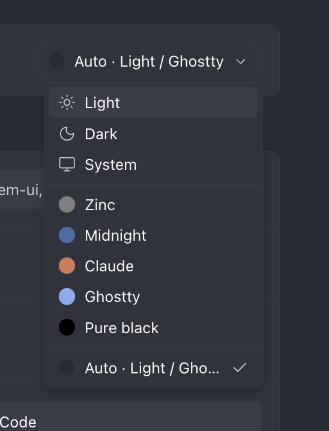

# Paseo auto theme

Automatically use a Light palette when your device is in light mode and a Ghostty palette when it is in dark mode. Runs entirely in the Paseo client, independently of the daemon machine's appearance.

## Install

Requires Paseo 0.12.0 or later on both the daemon and the client, with plugins enabled.

```sh
paseo plugin install github:yboyer/paseo-auto-theme
```

In **Settings → Appearance → Theme**, select **Auto · Light / Ghostty** once. Keep this theme selected rather than Paseo's built-in **Auto** option. Subsequent system appearance changes replace the plugin's palette automatically.



The plugin contributes one adaptive theme. It does not select Paseo's built-in themes or alter their settings. Choosing another theme stops displaying this plugin's palette; disabling the plugin restores Paseo's fallback theme.

## Compatibility

- Browser and desktop clients follow `prefers-color-scheme`.
- iOS and Android use React Native's appearance notifications and refresh when the app returns to the foreground. An appearance override imposed by the host app can take precedence over the OS preference.
- If no preference is available, Light is used.

The palettes are adapted from Paseo's Light and Ghostty themes. The plugin API exposes fewer color tokens than the built-in themes, so sidebar, terminal, status, and accent details may differ. It does not discover or switch to arbitrary installed themes.

Section headings use the original themes' muted text colors. Paseo shares the plugin's `ring` token between these headings, focus rings, terminal bright black, and the highest surface tint, so those details cannot all match the originals simultaneously. For dark plugin themes, Paseo also forces the sidebar to share the main background; Ghostty's darker sidebar cannot be reproduced through the current public theme API.

## Development

```sh
npm ci
npm run lint
npm test
```

Paseo compiles the TypeScript source itself; no production build or runtime dependency installation is required.

For a local installation:

```sh
paseo plugin install /absolute/path/to/paseo-auto-theme
paseo plugin reload paseo-auto-theme
```

Automated tests cover startup in both modes, light/dark transitions, stable theme IDs, repeated events, cleanup/reload, missing preferences, and native foreground synchronization. Device-level checks are still needed to verify the appearance behavior of each Paseo client release.
